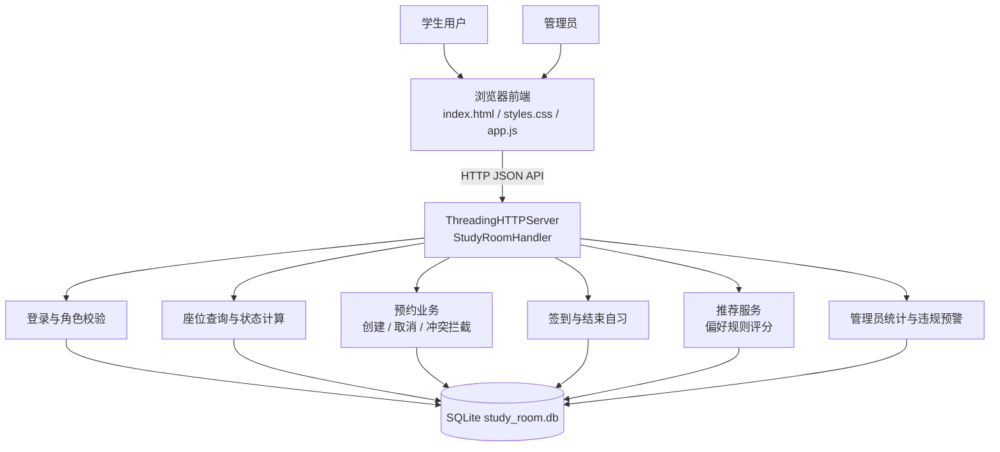
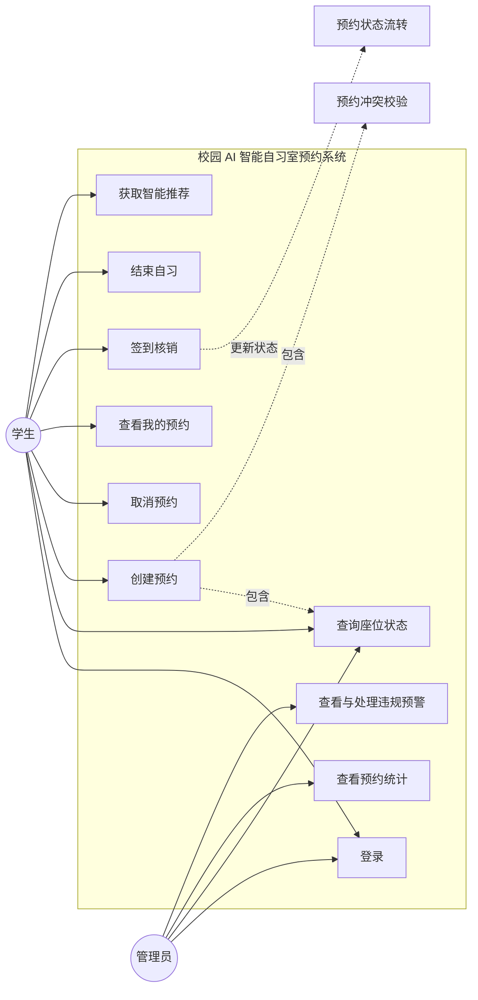
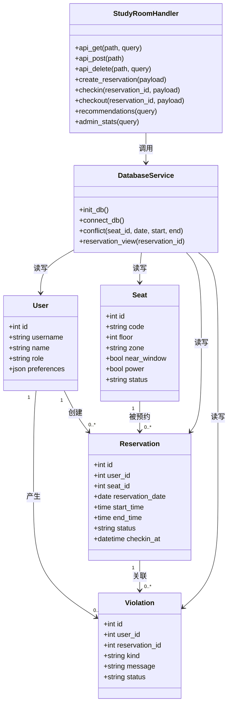
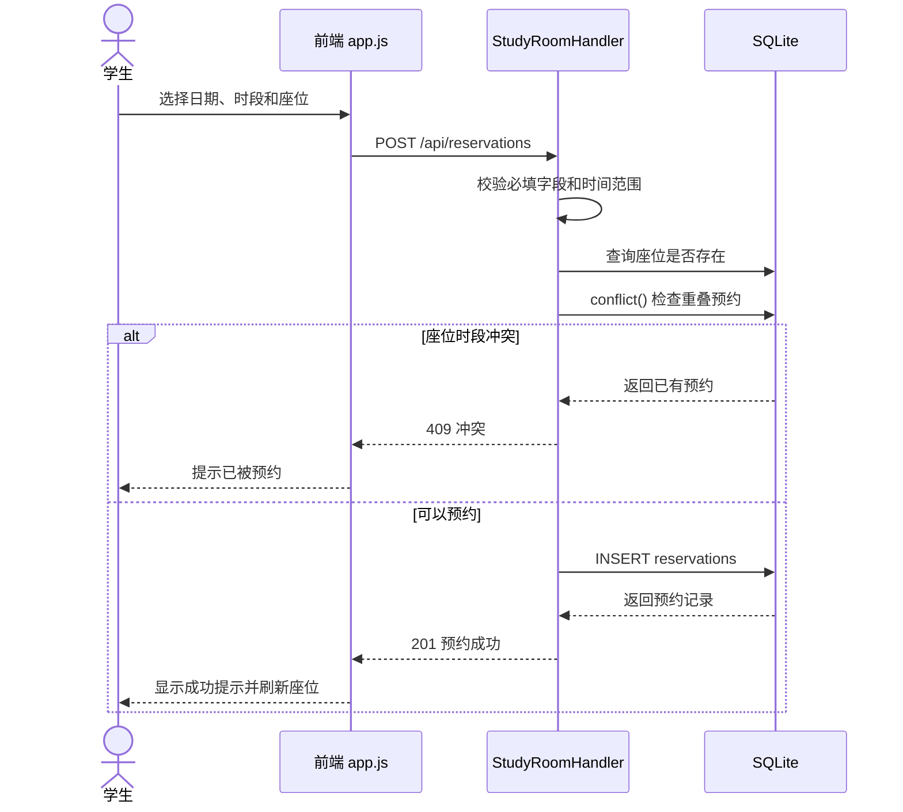
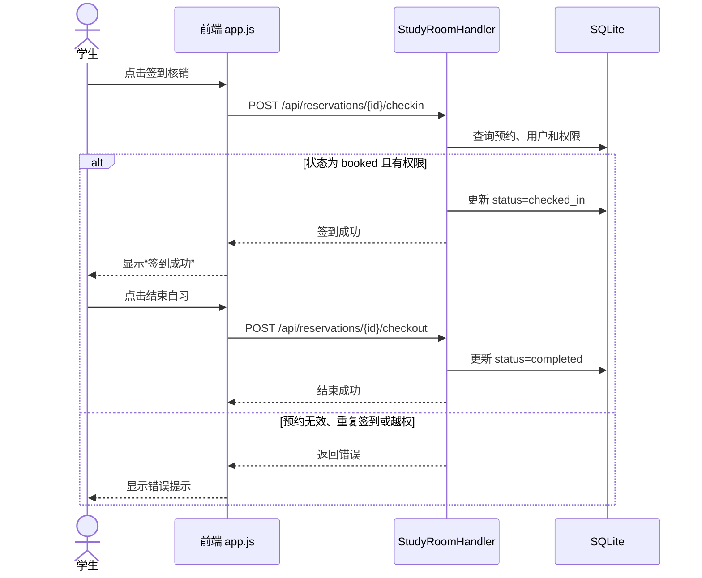
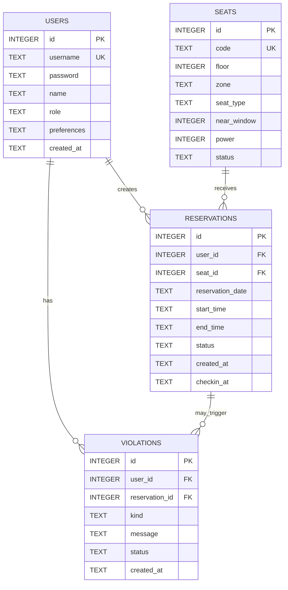
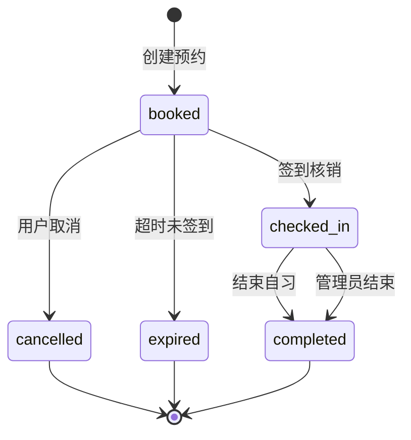

# 校园 AI 智能自习室预约系统设计图稿

本图稿根据当前仓库中的 `backend/server.py`、`frontend/app.js` 和 SQLite 建表语句整理。图中名称与现有代码保持一致，暂不涉及尚未实现的功能。

## 1. 总体架构图

## 2. 系统用例图

## 3. 核心类图

## 4. 创建预约时序图

## 5. 签到与结束自习时序图

## 6. 数据库 E-R 图

## 7. 预约状态流转图

## 8. 代码接口与图的对应关系

| 设计对象 | 当前代码对应位置 |
|---|---|
| 登录用例 | `POST /api/login`、`frontend/app.js` 的 `login()` |
| 座位查询 | `GET /api/seats`、`build_seats()`、`loadSeats()` |
| 创建预约 | `POST /api/reservations`、`create_reservation()` |
| 冲突拦截 | `conflict()` 和 `create_reservation()` |
| 签到核销 | `POST /api/reservations/{id}/checkin`、`checkin()` |
| 结束自习 | `POST /api/reservations/{id}/checkout`、`checkout()` |
| 推荐 | `GET /api/recommendations`、`recommendations()` |
| 管理统计 | `GET /api/admin/stats`、`admin_stats()` |
| 违规预警接口 | `GET /api/admin/violations`、`POST /api/admin/violations/{id}/resolve` |
| 数据模型 | `backend/server.py` 中的 `users`、`seats`、`reservations`、`violations` 建表语句 |

## 9. 当前版本需要在答辩中说明的边界

- 当前推荐使用规则评分，属于可解释的轻量化推荐，不是机器学习模型。
- 当前后端使用 SQLite，适合课程设计演示；若部署为多人生产系统，可以替换为 MySQL。
- 当前已实现预约冲突校验和多线程 HTTP 服务，正式报告中的并发压力测试还需要单独补充测试数据和测试结果。
- 违规记录表和管理员预警接口已经预留，但当前原型没有自动生成复杂的违规判定规则，后续可以补充“预约后未签到”等规则。
