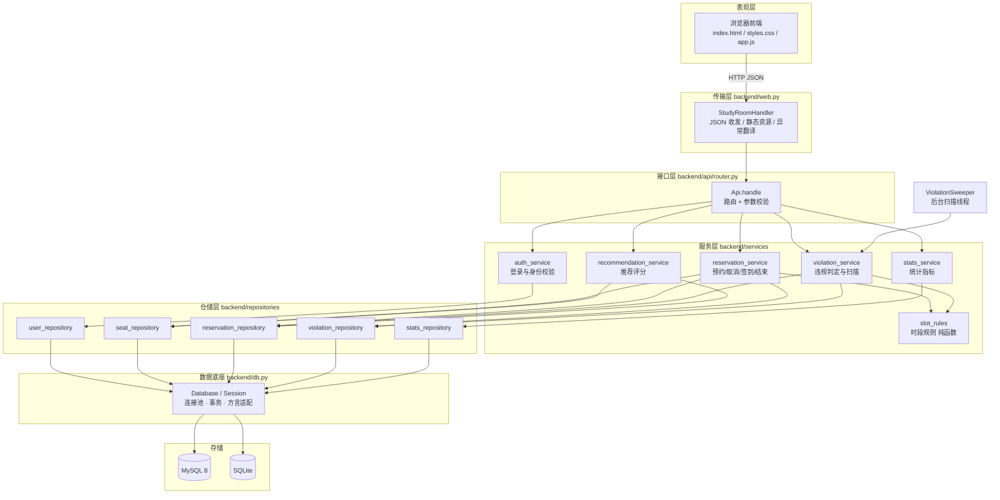
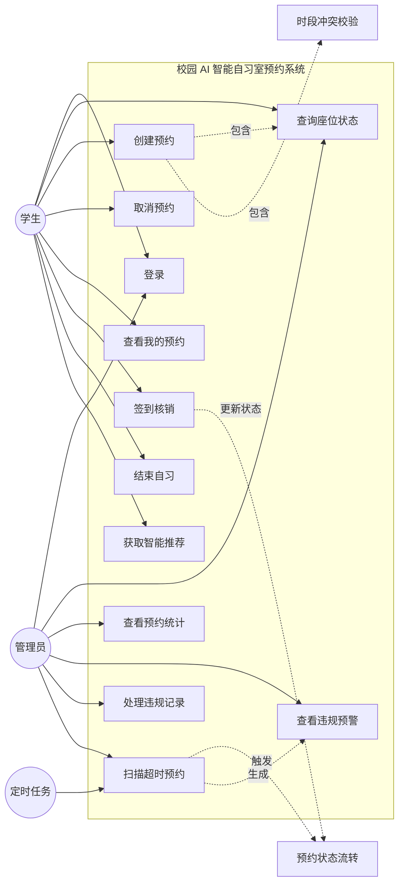
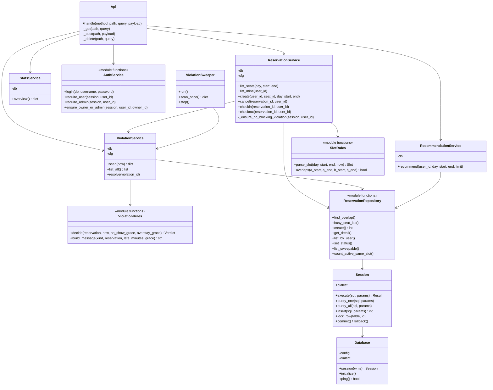
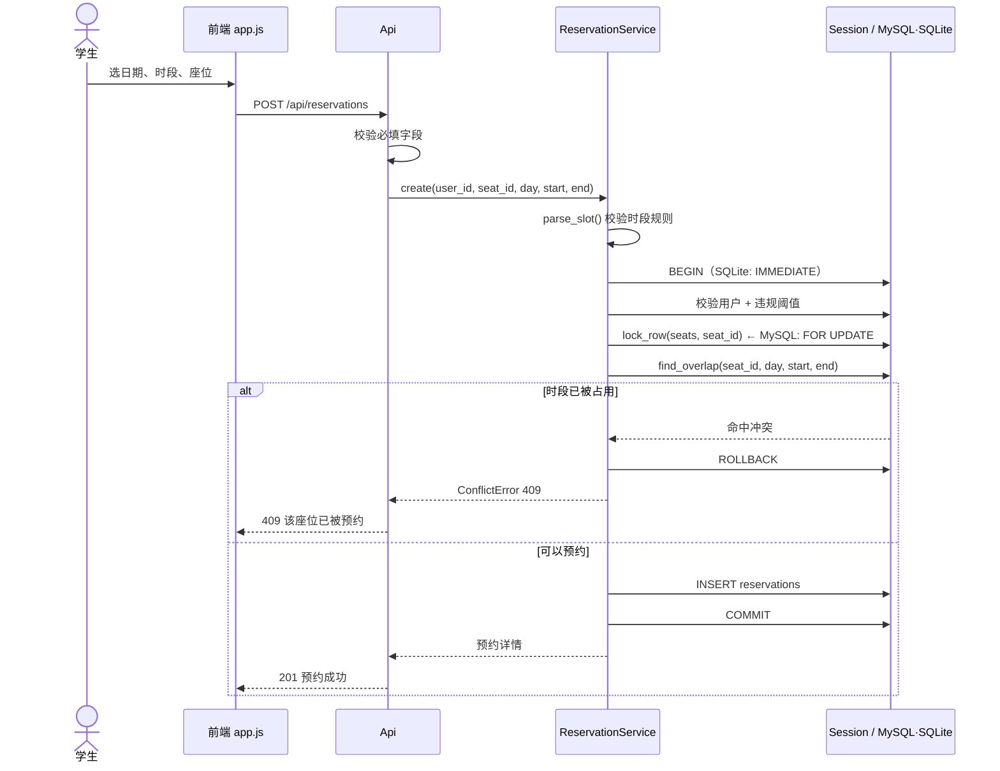
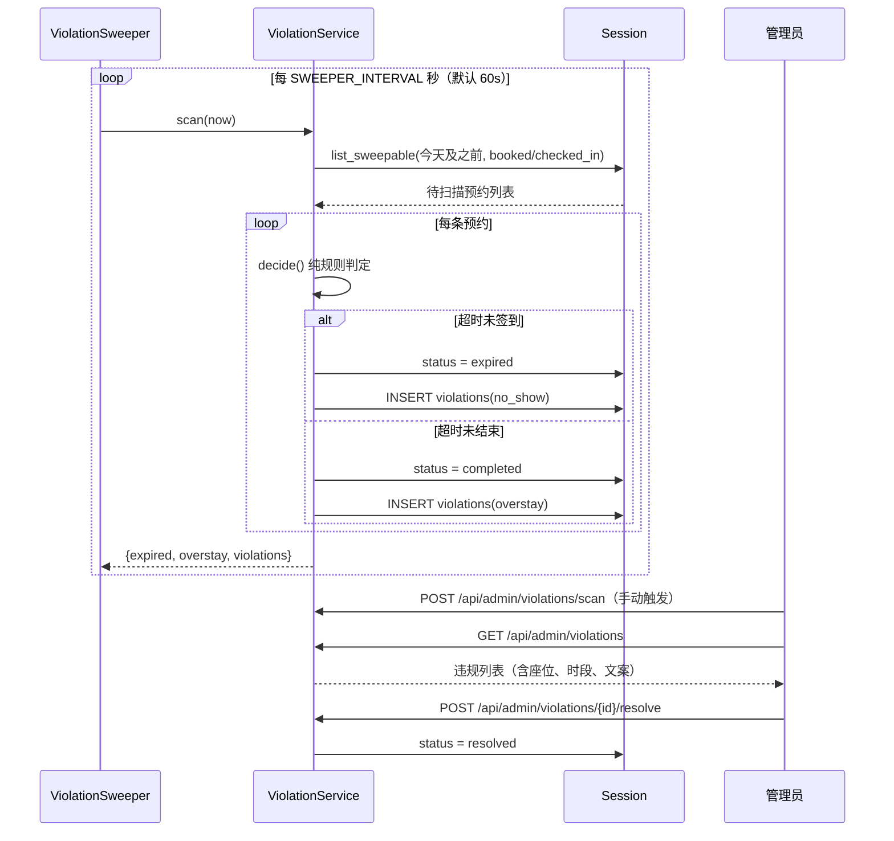
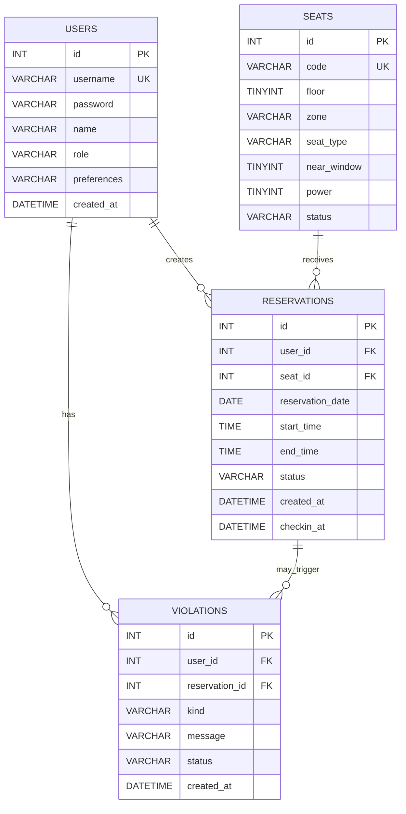
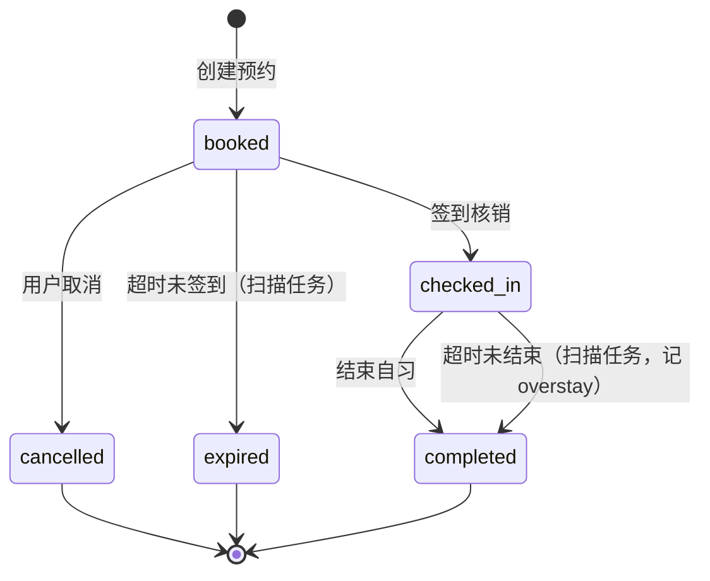

# 校园 AI 智能自习室预约系统 · 设计图稿 v2.0

本图稿与 `backend/` 下的实际代码一一对应（v2.0 分层重构后）。图中类名、模块名、文件名均取自当前代码，可直接用于答辩讲解。

---

## 1. 分层架构

**依赖方向严格单向**：传输层 → 接口层 → 服务层 → 仓储层 → 数据底座。上层不写 SQL，下层不认识 HTTP。

---

## 2. 模块划分（对应任务书「五大模块」）

| 任务书模块 | 代码位置 | 职责 |
| --- | --- | --- |
| 用户模块 | `services/auth_service.py`、`repositories/user_repository.py` | 登录、身份校验、角色判定、用户列表 |
| 预约模块 | `services/reservation_service.py`、`services/slot_rules.py`、`repositories/{seat,reservation}_repository.py` | 座位查询、时段校验、创建/取消预约、签到核销、结束自习 |
| 智能推荐模块 | `services/recommendation_service.py` | 空闲座位筛选与可解释打分排序 |
| 后台管理模块 | `services/violation_service.py`、`backend/sweeper.py`、`api/router.py`（admin 路由） | 违规占座判定与预警、定时扫描、违规处理、权限校验 |
| 数据统计模块 | `services/stats_service.py`、`repositories/stats_repository.py` | 预约总量、今日、在学人数、取消率、违规率、热门座位、趋势、时段与楼层分布 |

---

## 3. 系统用例图

---

## 4. 核心类图

> 与 v1 图稿的差异：v1 中虚构的 `DatabaseService` 类已删除（原代码里其实是模块级函数），改为与代码一致的 `Database` / `Session` 两个类；新增服务层与仓储层的边界。

---

## 5. 时序图：创建预约（并发安全）

关键是「锁 → 查 → 写」在同一事务内完成，杜绝两个请求同时通过冲突检查。

---

## 6. 时序图：违规扫描与预警

---

## 7. 数据库 E-R 图

关键约束：

| 约束 | 作用 |
| --- | --- |
| `uk_reservation_user_slot(user_id, reservation_date, start_time, end_time)` | 同一用户同一时段不可重复预约（数据库兜底） |
| `uk_violation_reservation_kind(reservation_id, kind)` | 同一预约同类违规只记一次（扫描幂等） |
| `idx_reservation_slot(seat_id, reservation_date, start_time, end_time)` | 冲突检查走索引 |
| `idx_reservation_status(status, reservation_date)` | 扫描任务按状态过滤 |
| `idx_violation_user(user_id, status, created_at)` | 违规阈值统计 |

> SQLite 版本见 `database/sqlite/schema.sql`，字段语义一致，仅类型与自增写法不同。

---

## 8. 预约状态流转

v1 中 `expired` 只存在于图里、代码从不产生；v2 起由违规扫描真实触发。

---

## 9. 目录与职责对照

| 路径 | 职责 |
| --- | --- |
| `backend/app.py` | 装配入口：初始化库 → 装配服务 → 启动扫描线程 → 起 HTTP 服务 |
| `backend/server.py` | 兼容入口（`python backend/server.py`） |
| `backend/config.py` | 环境变量配置（库选型、违规规则、服务端口） |
| `backend/db.py` | 连接池、事务、加锁、方言适配、初始化 |
| `backend/web.py` | HTTP 传输层与静态资源 |
| `backend/api/router.py` | 路由表与参数校验 |
| `backend/services/` | 业务规则（5 个模块 + 2 组纯函数） |
| `backend/repositories/` | SQL 读写 |
| `backend/sweeper.py` | 违规扫描后台线程 |
| `database/mysql/` | MySQL 建表与初始化脚本 |
| `database/sqlite/` | SQLite 建表与初始化脚本 |
| `tests/` | 单元测试 + 集成测试 + 并发测试 |
| `scripts/loadtest.py` | HTTP 层并发压力测试 |
| `scripts/init_mysql.py` | MySQL 一键初始化 |
