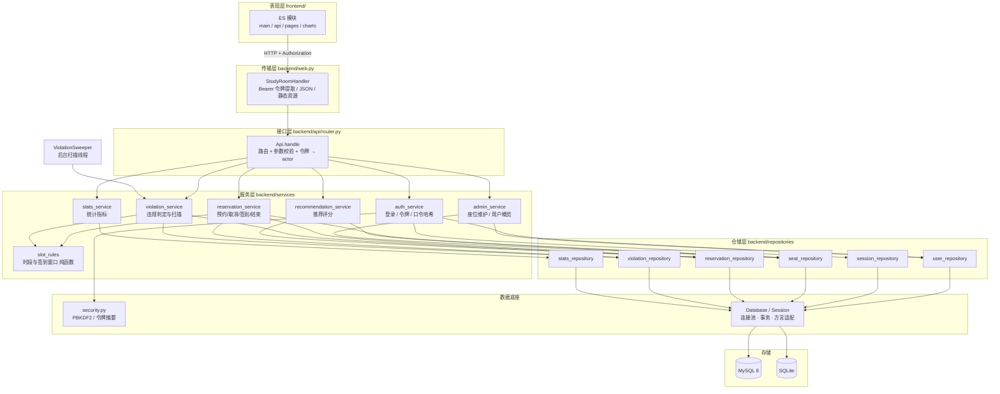
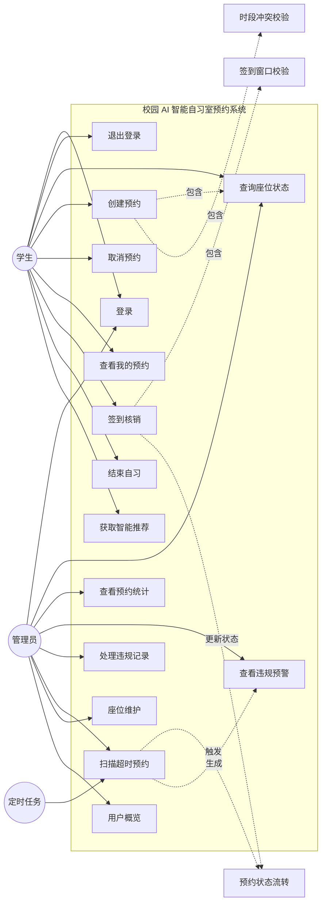
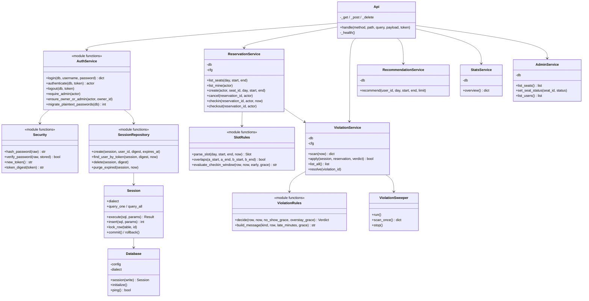
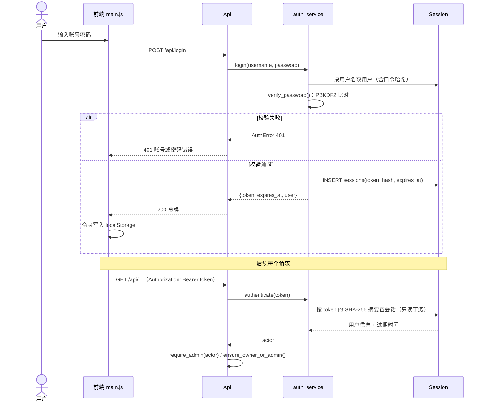
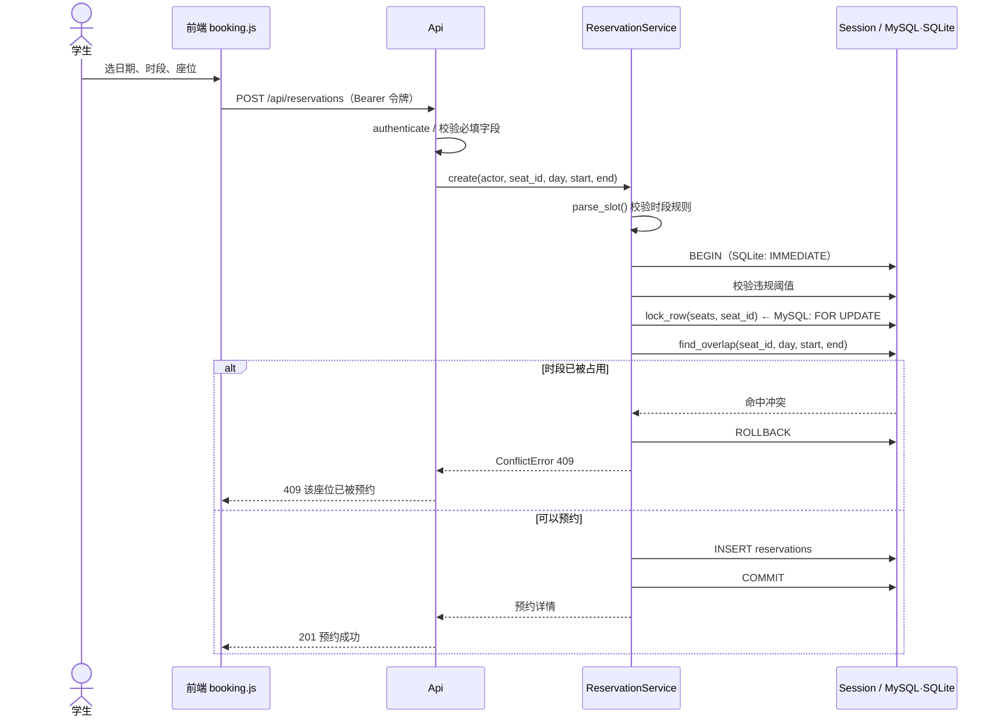
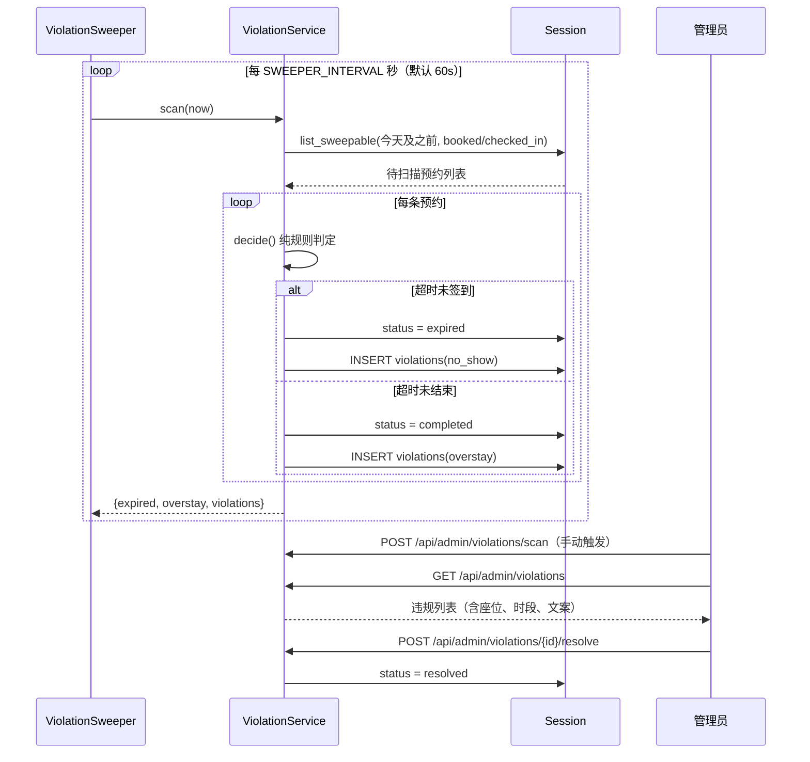
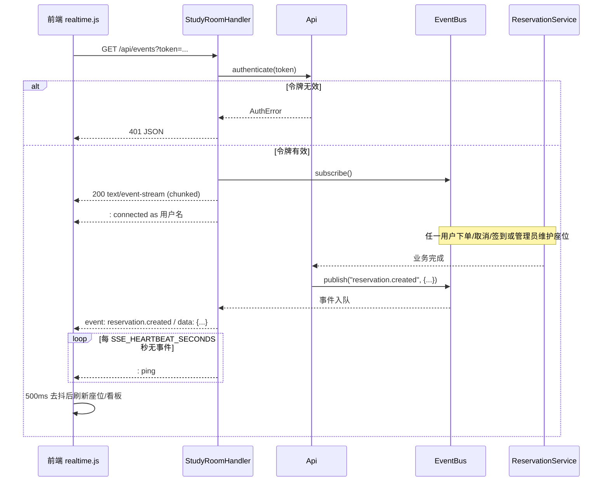
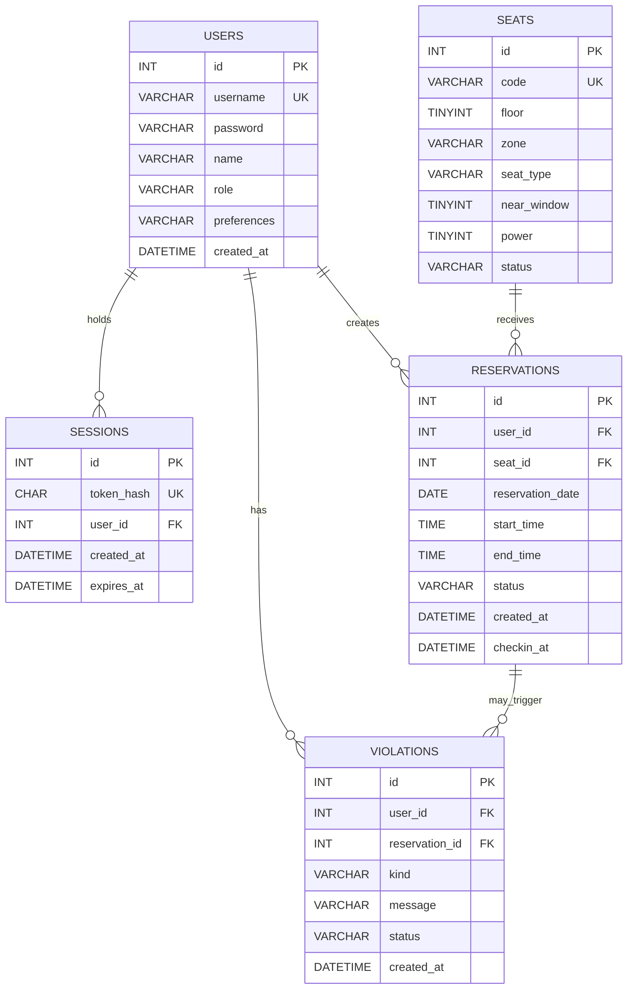
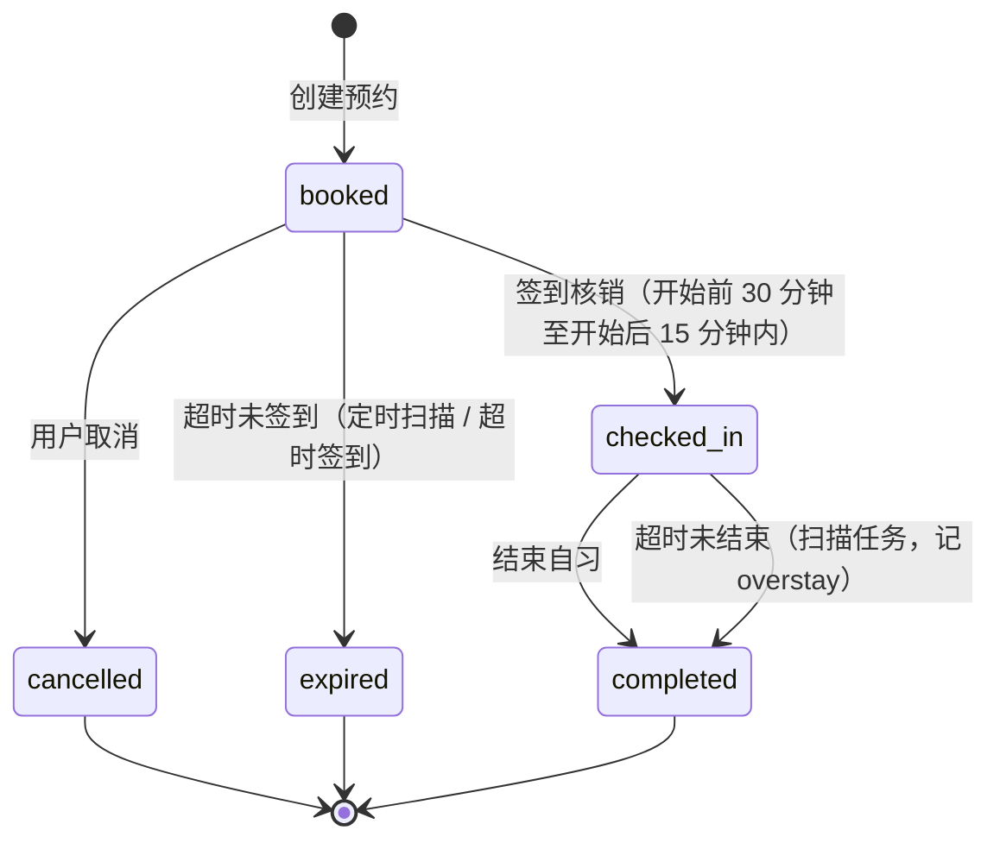
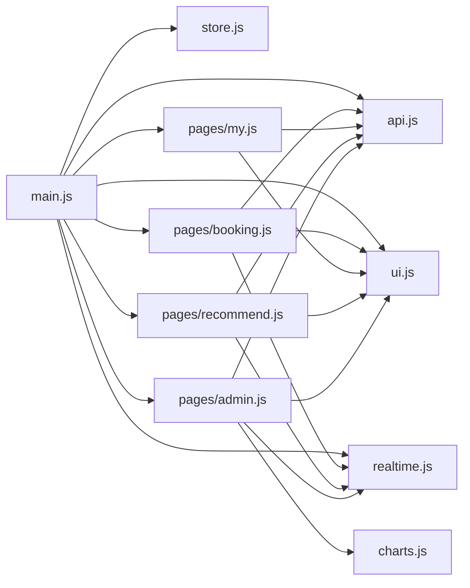

# 校园 AI 智能自习室预约系统 · 设计图稿 v2.2

本图稿与 `backend/`、`frontend/js/` 下的实际代码一一对应（v2.2：分层重构 + 令牌鉴权 + SSE 实时推送 + 前端模块化）。图中类名、模块名、文件名均取自当前代码，可直接用于答辩讲解。

---

## 1. 分层架构

**依赖方向严格单向**：传输层 → 接口层 → 服务层 → 仓储层 → 数据底座。上层不写 SQL，下层不认识 HTTP。

---

## 2. 模块划分（对应任务书「五大模块」）

| 任务书模块 | 代码位置 | 职责 |
| --- | --- | --- |
| 用户模块 | `services/auth_service.py`、`services/admin_service.py`、`repositories/user_repository.py`、`repositories/session_repository.py`、`security.py` | 登录、令牌签发与校验、口令 PBKDF2 哈希、角色判定、用户概览 |
| 预约模块 | `services/reservation_service.py`、`services/slot_rules.py`、`repositories/{seat,reservation}_repository.py` | 座位查询、时段校验、签到时间窗口、创建/取消预约、签到核销、结束自习 |
| 智能推荐模块 | `services/recommendation_service.py` | 空闲座位筛选与可解释打分排序 |
| 后台管理模块 | `services/violation_service.py`、`services/admin_service.py`、`backend/sweeper.py`、`api/router.py`（admin 路由） | 违规判定与预警、定时扫描、违规处理、座位维护、权限校验 |
| 数据统计模块 | `services/stats_service.py`、`repositories/stats_repository.py` | 预约总量、今日、在学人数、取消率、失约率、热门座位、趋势、时段与楼层分布 |

---

## 3. 系统用例图

---

## 4. 核心类图

---

## 5. 时序图：登录与令牌鉴权（v2.1）

设计要点：

1. **令牌只存摘要**：库里是 `sha256(token)`，即使数据库泄露也无法直接复用令牌；
2. **鉴权走只读事务**：每个请求都会鉴权，若在此处做任何写操作都会抢写锁（SQLite 为库级串行锁），因此令牌采用「登录时刻起算的绝对有效期」，不在请求路径上刷新活跃时间；
3. **身份不来自前端**：`user_id` 参数已从所有接口移除，越权只能靠「拿到别人的令牌」，而不是改一个数字。

---

## 6. 时序图：创建预约（并发安全）

关键是「锁 → 查 → 写」在同一事务内完成，杜绝两个请求同时通过冲突检查。

---

## 7. 时序图：违规扫描与预警

「超时签到」与扫描共用同一套规则：`ReservationService.checkin` 判定为 `late` 时调用 `ViolationService.apply()`，保证线上判定与定时任务口径一致。

---

## 8. 时序图：SSE 实时推送（v2.2）

要点：

1. **发布不阻塞**：订阅队列满时丢弃最旧事件，慢客户端不会拖住请求线程；
2. **连接有上限**：超过 `SSE_MAX_CLIENTS`（默认 50）返回 503，防止线程被占满；
3. **鉴权方式**：`EventSource` 无法自定义请求头，因此允许 `?token=` 传令牌；令牌仍是短期会话令牌；
4. **单进程**：事件总线是进程内实现，多进程部署需换 Redis Pub/Sub，`EventBus` 接口保持不变。

---

## 9. 数据库 E-R 图

关键约束：

| 约束 | 作用 |
| --- | --- |
| `uk_sessions_token(token_hash)` | 令牌摘要唯一，按摘要查会话走索引 |
| `uk_reservation_user_slot(user_id, reservation_date, start_time, end_time)` | 同一用户同一时段不可重复预约（数据库兜底） |
| `uk_violation_reservation_kind(reservation_id, kind)` | 同一预约同类违规只记一次（扫描幂等） |
| `idx_reservation_slot(seat_id, reservation_date, start_time, end_time)` | 冲突检查走索引 |
| `idx_reservation_status(status, reservation_date)` | 扫描任务按状态过滤 |
| `idx_violation_user(user_id, status, created_at)` | 违规阈值统计 |

> SQLite 版本见 `database/sqlite/schema.sql`，字段语义一致，仅类型与自增写法不同。

---

## 10. 预约状态流转

签到窗口：`[开始 - CHECKIN_EARLY_MINUTES, 开始 + NO_SHOW_GRACE_MINUTES]`，区间外分别返回「还未到签到时间」与「已超过签到截止时间（预约失效并记违规）」。

---

## 11. 目录与职责对照

| 路径 | 职责 |
| --- | --- |
| `backend/app.py` | 装配入口：初始化库 → 迁移明文口令 → 装配服务 → 启动扫描线程 → 起 HTTP 服务 |
| `backend/server.py` | 兼容入口（`python backend/server.py`） |
| `backend/config.py` | 环境变量配置（库选型、鉴权、签到窗口、违规规则） |
| `backend/db.py` | 连接池、事务、加锁、方言适配、初始化 |
| `backend/security.py` | 口令 PBKDF2 哈希、令牌生成与摘要 |
| `backend/web.py` | HTTP 传输层、Bearer 令牌提取、CORS、静态资源 |
| `backend/api/router.py` | 路由表、参数校验、令牌 → actor |
| `backend/services/` | 业务规则（用户 / 预约 / 违规 / 推荐 / 统计 / 后台管理 + 2 组纯函数） |
| `backend/repositories/` | SQL 读写（含会话表 `session_repository`） |
| `backend/events.py` | 进程内事件总线（SSE 数据源，慢消费者丢最旧、订阅上限） |
| `backend/sweeper.py` | 违规扫描后台线程 |
| `frontend/js/` | 前端 ES 模块：`api` / `store` / `ui` / `charts` / `pages/{booking,my,recommend,admin}` / `main` |
| `database/mysql/` | MySQL 建表与初始化脚本 |
| `database/sqlite/` | SQLite 建表与初始化脚本 |
| `tests/` | 单元测试 + 集成测试 + 并发测试 |
| `scripts/loadtest.py` | HTTP 层并发压力测试 |
| `scripts/init_mysql.py` | MySQL 一键初始化 |

---

## 12. 前端模块结构

| 模块 | 职责 | 关键导出 |
| --- | --- | --- |
| `js/api.js` | 统一请求封装、Bearer 头、401 处理 | `api.*`、`auth`、`ApiError` |
| `js/realtime.js` | SSE 订阅、断线状态、事件分发 | `connect`、`disconnect`、`subscribe` |
| `js/store.js` | 轻量状态与事件 | `state`、`setUser`、`on/emit` |
| `js/ui.js` | DOM 小工具、提示、状态徽章、时段选项 | `$`、`esc`、`toast`、`statusBadge` |
| `js/charts.js` | 自研 SVG 图表（零依赖） | `renderBars`、`renderLine`、`renderDonut`、`renderRankBars` |
| `js/pages/booking.js` | 座位查询与预约弹窗 | `init`、`refresh` |
| `js/pages/my.js` | 预约列表与签到/结束/取消 | `init`、`refresh` |
| `js/pages/recommend.js` | 推荐列表与一键预约 | `init`、`refresh` |
| `js/pages/admin.js` | 概览 / 违规 / 座位 / 用户四个页签 | `init`、`refresh` |
| `js/main.js` | 会话恢复、页面切换、全局事件 | — |

